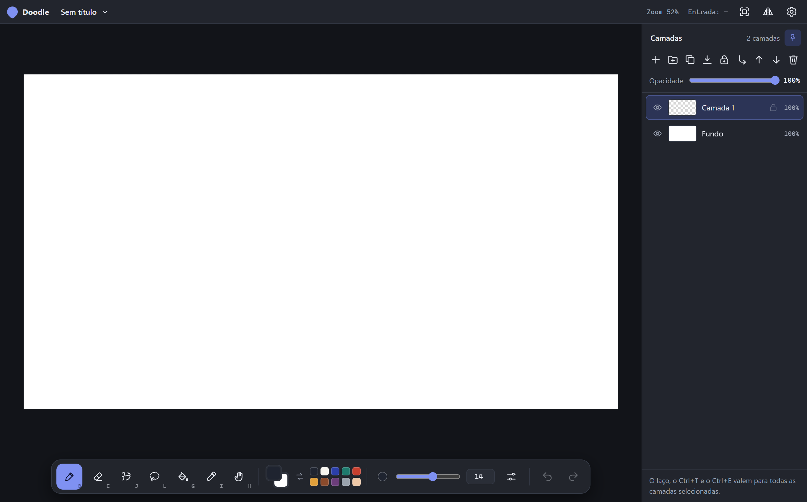
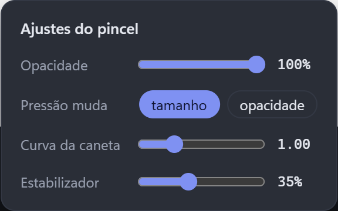
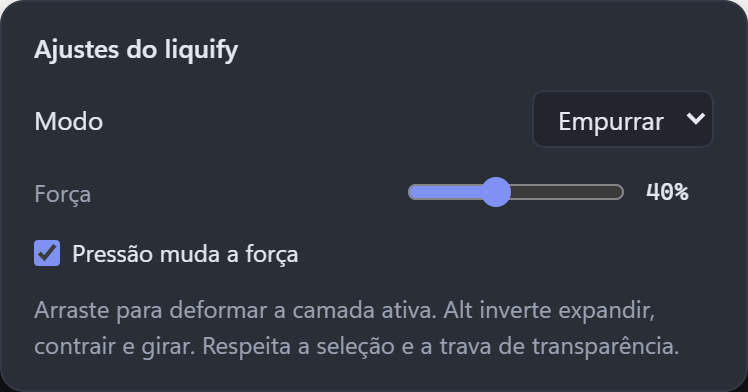

[English](README.md) · [Português (Brasil)](LEIA-ME.md)

# Doodle

Um app de desenho para rabiscar rápido. Abra uma tela e comece, com pressão da caneta, camadas, seleção e Liquify à mão.

**[Baixar a versão mais recente](https://github.com/VasahTS/Doodle/releases/latest)** · [Novidades](CHANGELOG.md) · [Relatar um problema](https://github.com/VasahTS/Doodle/issues)

## O que você pode fazer

| Recurso | O que oferece |
|---|---|
| **Desenhar com caneta** | Pincel e borracha com pressão, tamanhos de 0,1 a 500 px, curva de pressão e estabilizador ajustáveis. |
| **Organizar o desenho** | Camadas, pastas, opacidade, trava de transparência e recorte na camada de baixo. |
| **Selecionar e transformar** | Laço com somar/subtrair, barra de ações da seleção e transformação para mover, escalar, girar, inclinar ou distorcer. |
| **Usar Liquify** | Empurrar, expandir, contrair e girar a camada ativa, respeitando pressão, seleção e trava de transparência. |
| **Navegar pelo canvas** | Zoom, mão, rotação e espelhamento da vista. Personalize os atalhos para trabalhar como preferir. |
| **Continuar em outro editor** | Salve em OpenRaster com camadas, exporte PNG ou PSD com camadas editáveis. |

### Ajustes das ferramentas

As capturas mostram a interface real com o canvas vazio. O Doodle acompanha o tema claro ou escuro do sistema e está disponível em português do Brasil e inglês.

## Instalar

Abra a [versão mais recente](https://github.com/VasahTS/Doodle/releases/latest) e escolha o arquivo:

| Plataforma | Arquivo |
|---|---|
| **Windows x64** | Instalador terminado em `_x64-setup.exe`. |
| **Linux x64** | `.AppImage`, ou `.deb` para Debian/Ubuntu. |

Windows é a plataforma principal de desenvolvimento e testes. Também há pacotes para Linux; o desempenho pode variar entre sistemas.

O app instalado procura atualizações automaticamente. Para conferir manualmente, use **Configurações → Procurar atualizações**. Para mudar o idioma, use a mesma engrenagem e escolha **Idioma**.

## Salvar e continuar em outro editor

Use **.ora** como arquivo de trabalho: ele mantém camadas e pastas e pode ser aberto em editores como Krita e GIMP. O Doodle também abre imagens PNG e JPEG.

Exporte **PNG** para uma imagem final ou **PSD** para continuar com camadas editáveis em outro editor. Abrir arquivos PSD ainda não é suportado.

## Recuperação e desempenho

A recuperação automática guarda versões separadas do desenho. Em **Configurações → Recuperação automática**, você pode restaurar uma cópia ou ajustar intervalo e limite de armazenamento. As cópias complementam o salvamento normal; continue salvando seu ORA.

As configurações também oferecem ajustes de gráficos, qualidade da prévia e limites do histórico. Se uma ferramenta ficar lenta, salve um diagnóstico local depois de reproduzir o problema e anexe ao relato. Passadas extremas de Liquify ainda podem demorar para concluir em máquinas mais lentas; veja as [medições e limites](docs/performance-liquify.md).

## Compilar ou contribuir

Feito com Tauri, Rust e JavaScript puro. O [guia de desenvolvimento](docs/development.md) reúne instalação, estrutura do código e testes.

[Ideias e futuras adições](future-additions/README.md) · [Relatar problemas](https://github.com/VasahTS/Doodle/issues) · [Licença MIT](LICENSE)
