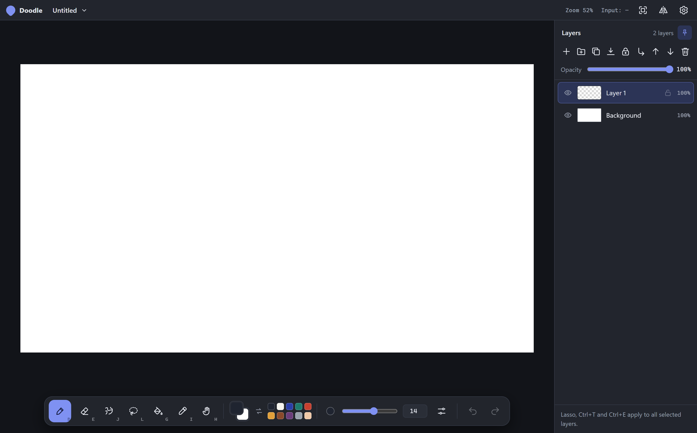
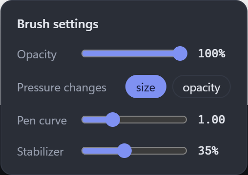
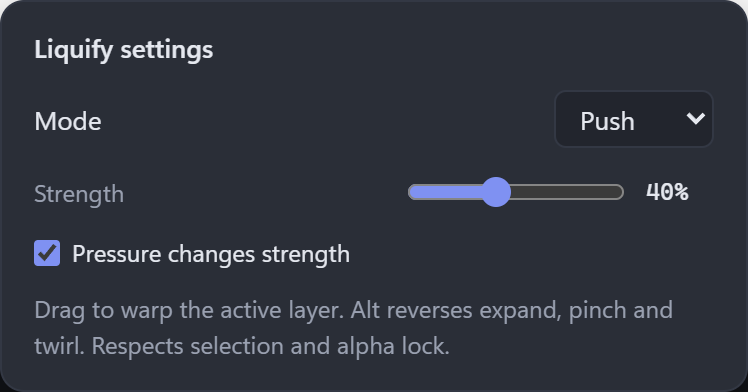

[English](README.md) · [Português (Brasil)](LEIA-ME.md)

# Doodle

A desktop drawing app for quick sketches. Open a canvas and start drawing, with pen pressure, layers, selections and Liquify close at hand.

**[Download the latest release](https://github.com/VasahTS/Doodle/releases/latest)** · [What's new](CHANGELOG.md) · [Report an issue](https://github.com/VasahTS/Doodle/issues)

## What you can do

| Feature | Details |
|---|---|
| **Draw with a pen** | Pressure-sensitive brush and eraser, sizes from 0.1 to 500 px, adjustable pressure curve and stabilizer. |
| **Organize your drawing** | Layers, folders, opacity, transparent-pixel locks and clipping to the layer below. |
| **Select and reshape** | Lasso with add/subtract, a selection action bar, and move, scale, rotate, skew or distort with free transform. |
| **Use Liquify** | Push, expand, pinch and twirl on the active layer, with pressure, selection and alpha-lock support. |
| **Move around the canvas** | Zoom, pan, rotate and mirror the view. Customize the keyboard shortcuts to match your workflow. |
| **Keep your layers** | Save editable OpenRaster files, export PNG or layered PSD, and continue in another editor. |

### Tool controls

The screenshots show the actual interface with an empty canvas. Doodle follows the system's light or dark appearance and is available in English and Brazilian Portuguese.

## Install

Open the [latest release](https://github.com/VasahTS/Doodle/releases/latest) and choose your package:

| Platform | File |
|---|---|
| **Windows x64** | The installer ending in `_x64-setup.exe`. |
| **Linux x64** | `.AppImage`, or `.deb` for Debian/Ubuntu. |

Windows is the primary development and testing platform. Linux packages are also available; performance can differ between systems.

The installed app checks for updates automatically. You can also use **Settings → Check for updates**.

## Save and continue elsewhere

Use **.ora** as your working file: it keeps the drawing's layers and folders and opens in editors such as Krita and GIMP. Doodle also opens PNG and JPEG images.

Export **PNG** for a finished image, or **PSD** to keep editable raster layers in another editor. PSD import is not supported.

## Recovery and performance

Automatic recovery keeps separate versions of your work. You can restore a copy or adjust the interval and storage limit in **Settings → Automatic recovery**. Recovery copies complement normal saves; keep saving your ORA file.

Graphics, preview quality and history limits are available in **Settings**. If a tool feels slow, save a local diagnostic after reproducing it and include it in an issue. Extreme Liquify strokes can still take time to finish on slower machines; [measurements and limits](docs/performance-liquify.md) are documented.

## Build or contribute

Made with Tauri, Rust and plain JavaScript. See the [development guide](docs/development.md) for setup, source structure and tests.

[Ideas and planned additions](future-additions/README.md) · [Issue tracker](https://github.com/VasahTS/Doodle/issues) · [MIT license](LICENSE)
